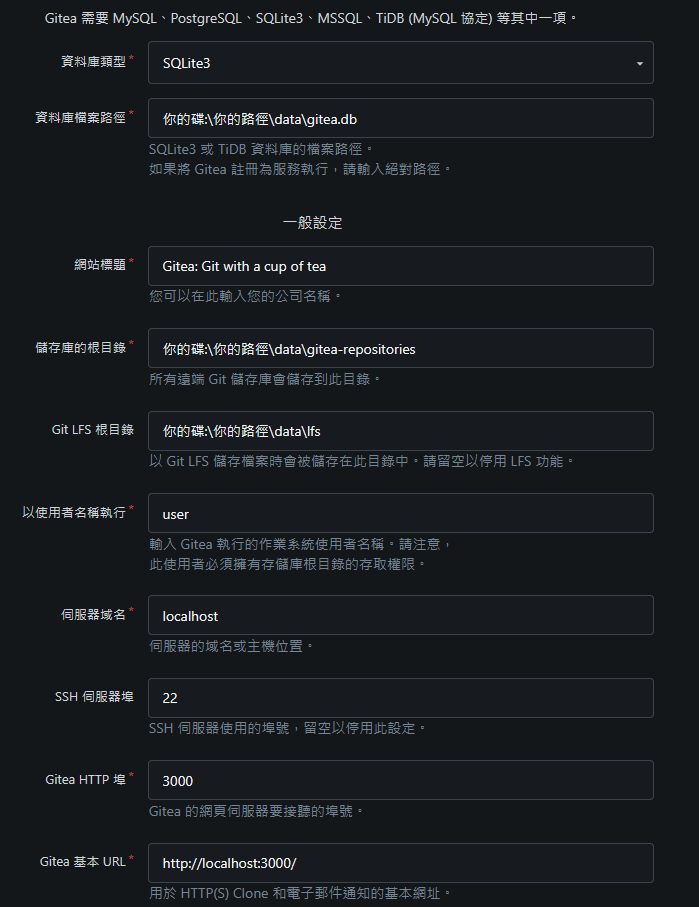
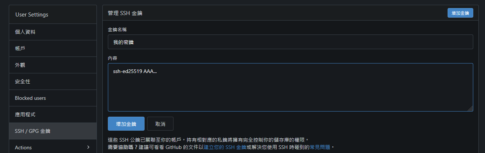
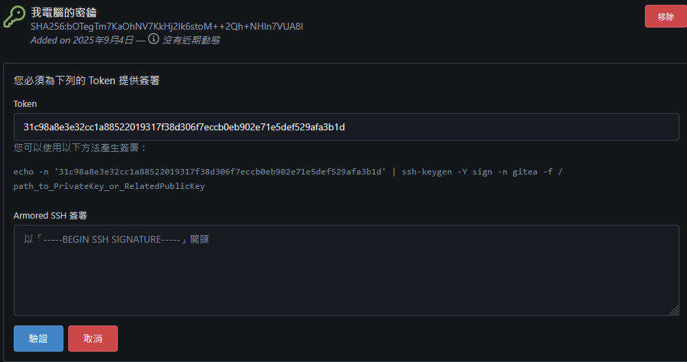
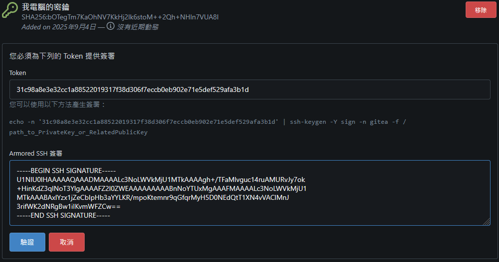
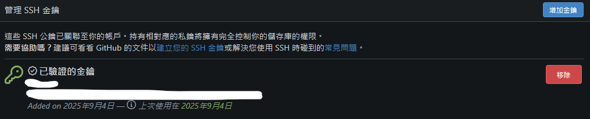

## Getting Gitea

Gitea is an open-source, self-hosted Git service.

Official download page: <https://about.gitea.com/products/gitea/>

## Setup



To begin, I recommend using the default settings.


**Note:** After setup, you may need to change the SSH user setting in `.\custom\conf\app.ini` to `git`, or use the account name of the host running the service when connecting. Otherwise, SSH authentication may not work correctly in this setup.


## Creating a Client SSH Key

Generate a key with:

```bash
ssh-keygen -t ed25519 -C "your_email@example.com"
```

You will usually be asked whether to use the default path or specify a different path and filename. Press Enter to accept the default. The output looks roughly like this:

```output
Generating public/private ed25519 key pair.
Enter file in which to save the key (C:\Users\username/.ssh/id_ed25519):
```

Next, you can set a passphrase to encrypt the key. In this example, I leave it empty:

```output
Enter passphrase (empty for no passphrase):
Enter same passphrase again:
```

You should then have two files:

- `C:\Users\username/.ssh/id_ed25519`
- `C:\Users\username/.ssh/id_ed25519.pub`

## Configuring SSH Access

Open `C:\Users\username/.ssh/id_ed25519.pub`. It contains a long line similar to:

```output
ssh-ed25519 AAA...
```

Paste it into the location shown below, under your account settings:



Next, use the temporary token to verify the SSH key:



The command is approximately:

```bash
echo -n 'the-token' | ssh-keygen -Y sign -n gitea -f C:\Users\username/.ssh/id_ed25519.pub
```


**Tip:** If you set a passphrase, enter it to generate the signature.


You will receive output like this:

```output
-----BEGIN SSH SIGNATURE-----
...
-----END SSH SIGNATURE-----
```

Copy and paste the signature here:



You should now be able to connect to your repository over SSH:



For example:

```bash
git clone ssh://gitea-ssh-user@your-domain:your-ssh-port/your-gitea-account/your-repo.git
```

## Closing Thoughts

This seemed so simple, but I was stuck on it for a long time. The main issue was that Gitea's SSH user was not necessarily `git`. You can change it to `git` if your setup continues to work correctly with that change.

HTTP access is also an option instead of the SSH approach described here, using an appropriate authorization flow such as browser-based authorization.
